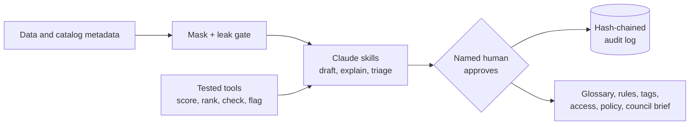

<div align="center">

# Claude for Data Governance Teams

**Stand up a working data governance baseline in weeks, not quarters.**
Claude drafts, explains and triages. Tested code computes every number. A named human decides.

   

[Value story](docs/VALUE_STORY.md) · [Guardrails](docs/guardrails.md) · [Plan](docs/PLAN.md) · [Run the demo](#try-it-in-60-seconds)

</div>

---

## The problem

Governance programs stall on the same work: definitions nobody agrees on, no clear list of what data matters, quality checked by hand, access decided one email at a time, and a monthly update nobody has time to write. A small team ends up producing policy documents instead of controlled data.

## The idea

A starter kit, modeled on how [Claude for Financial Services](https://www.anthropic.com/news/claude-for-financial-services) packages a domain: **skills** for the recurring jobs, **tools** that do the arithmetic and enforcement, **guardrails** that keep a human in charge, and a **roadmap** to get a team from zero to a running program. Insurance claims first; the method is industry-neutral.



## What it does

| Job | Skill | Tested tool | Try it |
|---|---|---|---|
| Define business terms | `define-business-term` | Rubric validator (14 checks) | `examples/glossary-validator` |
| Find the data that matters | `cde-identifier` | Transparent CDE scoring | `examples/cde-identifier` |
| Measure quality | 7 claims DQ skills | 7 rules, scorecard, planted-defect tests | `examples/claims-demo` |
| Find sensitive columns | (in DQ suite) | Name-based tagger | `examples/claims-demo` |
| Know what breaks | `lineage-explainer` | Impact graph walker, regulatory reports flagged | `examples/lineage` |
| Decide access | `access-request-reviewer` | Fail-closed tiered policy check | `examples/access-review` |
| Map regulation to controls | `policy-mapper` | Coverage matrix, build-next ranking | `examples/policy-mapper` |
| Report to the council | `council-briefer` | Deltas, SLA breaches, coverage flags | `examples/council-brief` |
| Stay safe | n/a | Masking, leak gate, tamper-evident audit log | `examples/safeguards` |
| Onboard stewards | `goviq-steward-onboarding-coach` | n/a | `skills/` |

15 skills, 9 example folders, 71 automated tests, standard library only.

## Try it in 60 seconds

Needs Python 3. Nothing to install.

```bash
git clone https://github.com/uchejerla/Claude-for-Data-Governance-Team.git
```

```bash
cd Claude-for-Data-Governance-Team && python3 examples/end-to-end/run_demo.py
```

One command runs the whole chain on synthetic insurance claims: quality scorecard, sensitive columns, critical data elements, lineage impact, access decisions, policy coverage, glossary check, council brief, then masking and a tamper-detection check on the audit log.

## Design principles

1. **Claude proposes, a named person decides.** Nothing approves, publishes or grants access on its own.
2. **Numbers come from code.** Scores, counts, deltas and flags are computed and tested, not written by a model.
3. **Unknown stays unknown.** Gaps are marked `NEEDS INPUT` or `OPEN`, never filled with plausible text.
4. **Fail closed.** Unknown role, unknown tag or missing field denies or stops.
5. **Least data.** Claude sees metadata, counts and masked values, not raw sensitive records.

Each guardrail is labeled as enforced by tested code, instructed in a skill, or still to build in [docs/guardrails.md](docs/guardrails.md).

## Roadmap this kit supports

| Phase | Weeks | Outcome |
|---|---|---|
| Foundation | 0-2 | One domain scoped, access working, success measures agreed |
| Vocabulary and ownership | 3-6 | Approved glossary, CDEs listed, owners named |
| Quality and classification | 7-10 | Rules running on CDEs, first scorecard, sensitivity tags approved |
| Policy and operating model | 11-13 | Policies signed off, council cadence running |

Details, metrics and risks: [docs/PLAN.md](docs/PLAN.md).

## Honest status

| Done | Not yet |
|---|---|
| 15 skills and 9 tested tools on synthetic claims data | Run on real data or a real catalog |
| Masking, leak gate and hash-chained audit log as libraries | Wired into a live Claude workflow |
| Buyer-facing [value story](docs/VALUE_STORY.md) and [guardrails](docs/guardrails.md) | Collibra connector (needs a Collibra instance to test) |
| Plain statement of every limit in each README | Independent security or legal review; time-saved figures |

Scoring weights, the access policy, SLAs and the regulation themes are demo values. The policy mapper's themes are plain-language summaries, not legal text.

## Repository map

```
skills/       15 Claude skills (SKILL.md each)
examples/     tested tools with synthetic data; end-to-end/ chains them all
docs/         PLAN.md, VALUE_STORY.md, guardrails.md
```

## Contributing and license

Issues and pull requests are welcome once the open questions in the plan are settled (warehouse pairing, branding, compliance scope). No license has been chosen yet; until one is added, treat the contents as all rights reserved.
